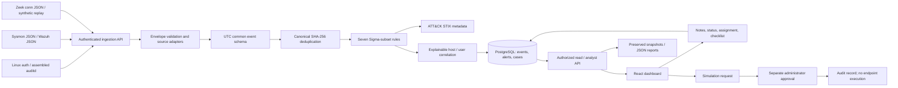

# Architecture

SentinelForge v0.1 is a modular monolith. One process keeps the ingestion-to-case transaction observable and easy to reproduce. PostgreSQL is the deployment database; SQLite/WAL is the local lab backend. The browser has no direct database access.



```mermaid
sequenceDiagram
  participant C as Collector
  participant A as FastAPI
  participant D as Database
  participant R as Detection engine
  C->>A: POST /api/ingest + bearer token
  A->>A: Role, body limit, envelope and adapter validation
  A->>D: Acquire writer lock
  loop Each valid envelope
    A->>D: Check fingerprint; persist normalized + raw event
    A->>R: Match rule selections and event-time threshold
    R->>D: Persist alert evidence and correlated case
  end
  A->>D: Append ingest audit and commit
  A-->>C: Per-event accepted / duplicate / rejected results
```

## Modules and contracts

| Module | Responsibility |
|---|---|
| `config.py`, `schemas.py` | Fail-closed credential config; bounded request/common-event schemas |
| `normalize.py` | Source-specific parsing; no command execution or remote lookup |
| `rules.py` | YAML loading, strict supported syntax, boolean AST evaluator |
| `engine.py` | Threshold evaluation, evidence links, suppression, correlation, risk |
| `db.py` | SQLAlchemy schema, database setup, exact event fingerprint constraint |
| `api.py` | Authentication, authorization, streaming size cap, IP limiter, operations |
| `frontend/src` | Typed React client and dashboard; secrets stay in browser memory |
| `scripts` | Explicit setup, replay, STIX update, evaluation, benchmark, smoke verification |

The normalized schema includes source, sensor, host, UTC timestamp, optional user, event kind/outcome, process/parent/command, source/destination IP and destination port, external ID and extension fields. Raw envelopes remain separately preserved. The transport identity and declared sensor are distinct: a collector is authorized to ingest, but v0.1 does not bind each collector token to particular host names.

## Data and consistency

- `events`: unique canonical fingerprint, timestamps, indexed source/host/SSH grouping fields, normalized JSON and original envelope.
- `alerts`: exact event IDs, rule ID/version metadata in rule files, ATT&CK IDs, severity/confidence, rationale and correlation reason.
- `cases`: status, assignee, first/last observation, hosts/users, risk and investigation checklist.
- `notes`, `audit`, `responses`: appended notes/actions and approval state.
- `evidence`: frozen case/event snapshots and SHA-256 manifests.
- `iocs`: explicit operator-managed IP labels and source attribution.

One batch is one commit. Invalid telemetry is reported per item; internal/database errors abort the whole transaction. Exact content replays do not emit additional alerts. A unique constraint is the final deduplication guard. The Python writer lock serializes all mutation routes; PostgreSQL also takes a transaction-scoped advisory lock. SQLite is supported with **one application worker only**. There is no durable intake queue, worker retry scheduler or multi-process SQLite guarantee.

## Correlation and risk

An alert joins an open/non-closed case when the event lies within 15 minutes of the case activity interval and its host matches. Otherwise a non-generic username match may join it. Host matches take priority; latest activity wins deterministic ties. Generic users (`root`, `system`, `administrator`, unresolved audit IDs) never join different hosts solely by username. Cases are not transitively merged. Long continuing activity can extend a case indefinitely; a maximum case duration is a future improvement.

Risk = `min(100, highest severity weight + 5 × additional distinct techniques + min(15, 2 × additional alerts))`. Weights: low 20, medium 40, high 65, critical 85. This is a triage heuristic, not a compromise probability. Confidence values are authored rule metadata and also are not probabilities.

SSH rules use event time, accept out-of-order arrivals, require five matching events in 300 seconds, and suppress another alert within ±300 seconds of the existing alert anchor for that host/IP. New matching event IDs extend the evidence set. This is a documented custom aggregation extension, not the Sigma correlation specification.

## Deployment boundaries

The React build is served by FastAPI on the same origin. Tokens are bearer headers; there are no cross-origin credential cookies. PostgreSQL has no published host port. The API runs as UID 10001, read-only, with dropped capabilities, no privilege escalation, constrained memory/PIDs and a temporary `/tmp` filesystem. The Compose network is internal. Frontend fonts are bundled locally.

Schema v1 uses SQLAlchemy metadata creation for a new database. There are no automatic destructive migrations. Back up before changes; a migration framework, retention policy and least-privilege migration/runtime DB role split are planned. See [threat model](docs/THREAT_MODEL.md) before any exposed deployment.
